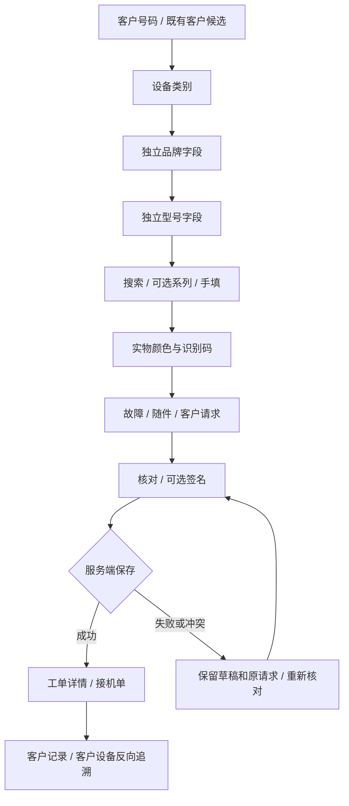
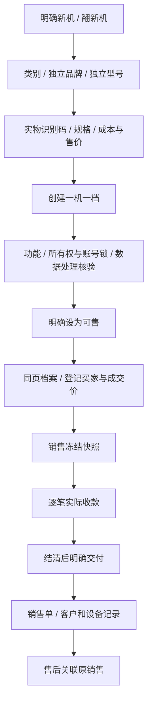

# 品牌与型号分开选择：设计预览和实施规划

规划日期：2026-10-14；实施授权：2026-10-15。状态：**独立选择器已实施，本地组件/交互/构建验收通过；真实本地Auth/API闭环通过；远程CI/生产发布按下列门槛继续验收。**

## 1. 要达到的结果

恢复两个独立、可搜索、可手填的品牌和型号字段。选品牌只操作品牌字段；选型号只打开型号候选。系列保留为型号候选里的**可选筛选**，不再要求走“品牌 → 系列 → 型号”的弹窗向导。

知道型号：选品牌 → 输入名称或机型码 → 选正确版本。浏览型号：选品牌 → 可选点系列 → 选型号。已有品牌的型号更正直接从型号字段开始。“两次选择”指品牌、型号两次候选确认，不把打开控件、输入和真实业务核对算成消失的操作。

维修接机、商品新建/同型号新建、商品品牌/型号逐项更正继续共用一个目录。商品、客户设备、目录参考仍是三个身份。颜色、RAM、存储、电池和检测结果由实物记录，不因选型号自动填写。

## 2. 项目适配与当前问题

本轮定向读取 PROJECT_MEMORY、组件规则、docs/06、docs/16、docs/32，以及当前目录控件、读取hook、商品控件和维修接机更新入口。结论：**适合本项目，可以主要通过控件和调用方调整完成，第一批不需要数据库迁移或重建目录。**

| 当前情况 | 问题或风险 | 处理方式 |
| --- | --- | --- |
| 品牌、系列、型号在同一个模态面板里连续选择 | 与表单中独立的品牌/型号字段不一致，容易忘记正在改哪个事实 | 两个独立搜索框，就地候选 |
| 已知型号也要经过系列步骤 | 多一次强制导航 | 搜索当前品牌全部系列，系列仅作可选筛选 |
| 原 DeviceCatalogControl 仍使用 groups/models 查询与分页 | 直接切回旧组件会重新引入逐次查询和翻页 | 复用外观，改接当前 useCatalogIndex |
| 两个字段独立更新后可能品牌已改、型号还是旧品牌 | 新建草稿形成错误组合 | 确认不同 canonical 品牌时，在一次领域更新里清理型号并提示 |
| 搜索输入与已确认事实混用 | 输入半个品牌就清理型号；Esc后留下半个查询词 | 查询文字与已确认草稿分开 |
| 手机候选高度固定 | 键盘遮挡、只有一条可见候选 | 按实际可视区上下展开，列表内部滚动 |
| 查询失败显示“没有匹配” | 用户误以为型号不存在 | 区分加载、空结果、网络失败、离线和身份失效 |
| 网络快但强制步骤多 | 操作仍感觉慢 | 首次查询、打开、搜索、筛选、确认、业务保存分别计时 |

以上为规划阶段的定向分析。用户随后授权实施并上线，独立字段已进入隔离候选；正式站在发布完成前仍是原组合控件。实际验收证据与剩余边界另记，不把预览或本地检查当线上验证。

## 3. 电脑端设计

- 沿用侧栏、PageTitle、白色面板、细边框和现有紫色主操作。
- 维修设备步骤两列：第一行类别 / 品牌，第二行型号 / 颜色，SN / IMEI独占一行。
- 品牌候选锚定品牌字段，型号候选锚定型号字段，一次只打开一个列表。
- 打开已选字段时先展示全部候选，输入后过滤，原值保持可辨认。
- 型号列表保留当前品牌、数量、可选系列、型号名称、网络版本、已有年份和机型码。缺年份不补造年份。
- 输入名称/机型码时搜索当前品牌全部系列，收起不必要的系列栏。4G、5G和不同机型码保持独立候选，以目录ID作为稳定key。
- 长列表复用窗口化与按需加载，不恢复上一页/下一页按钮。
- 手填与门店历史原文保留独立辅助入口和来源标记，不混进已选官方系列。
- 1024px保留电脑结构；长内容换行，不缩字号。

## 4. 手机端设计

- 767px及以下单栏；菜单按钮在标题行，不新增全局顶栏或底部主导航。
- 原四步接机流程横排；当前步骤显示编号，其余用文字，避免三语长词遮挡。
- 类别、品牌、型号逐行展示；输入16px，清空/展开/候选/主操作至少44px。
- 候选在当前字段附近展开；下方不足则向上，键盘变化后重新计算。不能变回组合选择抽屉。
- 浏览时显示单行系列筛选，输入已知型号时收起，把空间留给候选。
- **空值的颜色与SN / IMEI**可放入“更多设备信息”，已有值时展开，保存和草稿不丢值。电脑端始终展示。
- 上述折叠是本次预览的密度建议，可与选择器分开实施；不改变必填项。
- 下一步保留在表单操作区，不用固定底栏压住候选或键盘，不自动跳步。

移动键盘可能改变可视区而不改变布局视口，所以定位需跟随可视区resize/scroll，并单独验证实体设备。[MDN VisualViewport](https://developer.mozilla.org/en-US/docs/Web/API/VisualViewport)

## 5. 交互与防错契约

| 动作 | 正确行为 | 防止的问题 |
| --- | --- | --- |
| 打开、浏览候选 | 不修改已确认品牌/型号 | 打开即保存或写历史 |
| 输入搜索文字 | 只更新控件查询 | 输入“App”就删除原型号 |
| 选候选 / Enter确认 | 确认当前字段并关闭列表 | 一个选项触发两次领域更新 |
| 手填后Tab/离开字段 | 按既有长度和必填规则确认原文 | 自动选第一条近似型号 |
| Esc | 恢复原字段值，取消未确认查询 | 留下半个搜索词 |
| 中文输入法组合中Enter | 交给输入法，不选择/提交 | 拼音选字导致跳步 |
| 新建确认不同品牌 | canonical真正不同才清型号、系列和旧查询，并提示 | 新品牌配旧型号 |
| 新建清空品牌 | 清理旧型号关联；商品可重新手填无品牌型号，维修保留品牌必填 | 空品牌仍沿用旧官方身份 |
| 切类别 | 走领域更新，清理不适用品牌/型号/服务/核验草稿 | 手机候选残留在电脑表单 |
| 未收录型号 | 保留手填原文，实物仍须核对 | 将手填视为已核验资料 |
| 已有商品仅更正品牌 | 只更正品牌，核对时展示现有型号，不静默改型号 | 新建清理规则破坏旧档案 |
| 已有商品仅更正型号 | 固定当前品牌，仅改型号 | 顺带修改品牌 |
| 取消已有档案编辑 | 不保存、不追加历史 | 局部取消但父页面已写入 |
| 改动身份后保存 | 沿用商品检测/状态规则；维修重新核对服务、报价、同意与签名 | 旧核验代表新设备 |
| 身份/门店/权限变化 | 清候选和相应敏感草稿，旧响应不回填 | 继续用前一账号缓存 |

“撤销”只用于新建草稿的即时纠错。恢复品牌/型号仍要重新规范化，不恢复失效报价授权、检测、同意或签名；有后续新编辑或作用域变化即撤销恢复入口。正式实现不将业务恢复塞进公共SearchCombobox。

维修品牌100/型号160、商品品牌60/型号120等长度继续由调用方传入。显示译文、搜索别名、保存原文分别处理，语言切换不改canonical。

## 6. 维修完整闭环

品牌确认复用normalizeIntakeServices与intakeRequirements：清不适用服务和失效报价标题，重新要求核对，不把选品牌当维修授权。客户归一化、设备匹配、照片、签名快照和幂等继续保留。

保存成功后才显示完成和打印。失败不能出现“已保存”；重复点击不生成第二张工单。刷新读取真正已保存的记录；客户/设备能反向打开原工单。**预览保存、关联和打印仅演示设计，不证明真实后台边界已经通过。**

## 7. 商品完整闭环

本次组件改动重点是**新建、同型号新建、品牌/型号逐项更正**；销售、打印和客户关联作为相同事实的回归，不重建“单机管理”页面。

选型号不代表已检测，创建不等于在售，销售/收款/交付是分别核对的事实。旧销售和签署快照冻结，目录改名不能重写原单据。退回/退款/复检复售沿原路径，本轮不增加状态。

## 8. 响应速度规划

### 第一批：保留已有提速，减少操作等待

1. 保留picker-index、原受限授权事务、CatalogIndexPreload及请求合并。
2. 独立品牌/型号订阅同一个作用域索引，不能各请求一份。维修在客户步骤、商品进入新建时预取。
3. 完整索引就绪后，筛品牌、输入型号、切系列均在内存完成；不逐字符请求，也不加旧远程分页的150ms等待。
4. 按类别/品牌/目录版本建立稳定搜索索引；不扫描实物档案重建目录，不读成本/照片。
5. 复用候选窗口化、键盘活动项和目录ID；只渲染可见窗口，不缩文字。
6. 超3000型号沿原品牌/系列细化，超大叶子受限分页并自动加载。完整计数不能当作已读取所有型号。
7. 保留请求代次、最后订阅者取消、10秒读取上限、同版本小响应、30秒前台核验与身份失败阻断。
8. 加载及时反馈；网络失败保留手填草稿；离线/账号失效不伪报正式保存成功。

计算缓存用于减少重复工作，不能替代正确的依赖和作用域失效；额外缓存是否有收益由同规模测量决定。[React useMemo](https://react.dev/reference/react/useMemo)

### 第二批：按实测瓶颈继续优化

| 慢点 | 措施 | 需要先取得的证据 |
| --- | --- | --- |
| 首次认证慢 | 分析Auth/session时序和连接复用，保留授权 | Server-Timing auth/total |
| 目录读取或payload大 | 检查投影字段、分类范围、查询计划与索引 | catalog timing、数量、字节、查询计划 |
| 索引就绪但输入卡 | 找重复归一化、重建列表、长任务和过多DOM | 原生输入→稳定候选耗时/DOM数 |
| 大系列重复加载 | 检查游标、去重、合并和失效代次 | 操作请求数、末页/重复页反例 |
| 软键盘遮挡 | 改字段附近的候选定位 | 实体iPhone Safari / Android Chrome操作 |

不先引入外部搜索服务、公共CDN权限缓存、持久权限缓存、第二份维护表或全店快照；不恢复已放弃的性能分支。

### 建议验收口径

| 指标 | 目标/限制 | 方法 |
| --- | --- | --- |
| 已预加载打开、切系列、本地搜索 | P95 ≤200ms，各30样本 | 原生事件→实际可见候选→连续帧，不混测试RPC尾部 |
| 完整索引就绪后的选择 | 0额外目录查询 | 逐操作记请求，后台版本核验单列 |
| 首次索引准备 | 先争取正常P95 ≤1.5秒、模拟弱网≤3秒 | 冷暖分组、同规模各30样本，再定位瓶颈 |
| 慢请求恢复 | 即时反馈，沿现有10秒期限退出并可重试 | 延迟、超时、非JSON注入 |
| 超限细化 | 不使用截断结果；同查询只有一个合并中的请求 | 3000/3001、超大系列 |
| 输入与状态正确 | 没有持续长任务、错位或旧结果覆盖 | 快速切品牌/类别、撤权、响应乱序 |

**这里是建议门槛，不是本轮实测成绩。** 已有证据记录：旧合并控件的预加载CI Chrome P95约31–33ms，WebKit约56–120ms；本地真实Auth/数据库开发环境、130合成型号网络P95约351ms。旧结果说明提速值得保留，不证明新控件、生产冷启动或实体手机达标。本轮未压测生产。

## 9. 实施顺序与组件复用

| 阶段 | 交付 | 完成条件 |
| --- | --- | --- |
| 0 本轮 | 规划、双端三语预览与预览证据 | 可评审、主路径/异常可操作、示例边界明确 |
| 1 共用控件 | DeviceCatalogControl接useCatalogIndex，SearchCombobox只补必要opt-in | 字段不重复查询；普通客户/配件搜索不退化 |
| 2 调用方 | 维修、商品新建/复制、逐项编辑迁出组合面板 | 领域更新、锁、校验、取消、原文保持 |
| 3 逻辑回归 | 定向单元、真实本地API、双浏览器保存/刷新/关联 | 可恢复、可追溯；反例不产生部分成功 |
| 4 性能/三语 | 正式构建、同数据对照、四宽度/三语 | 暖交互达标，首次读取单列，键盘/长词可用 |
| 5 发布 | fresh main隔离变更、精确源码CI、候选和回退点 | 保留并行Office/Figma；核实际域名和只读流程 |

复用PageTitle、AppShell、InputControl、SearchCombobox、SelectControl、IdentifierField、目录hook、语义CSS和三语词典。实物、客户、销售和正式写权限仍留所属模块。所有调用方迁出后才移除组合面板；预加载可迁到独立目录模块。

当前预览是独立HTML/CSS/JS，便于脱离后台评审，**不是正式React组件实现**，不会接到正式路由。

## 10. 正式实施必验

| 范围 | 验收与反例 |
| --- | --- |
| 基本交互 | 分别打开/关闭；鼠标/触控、上下键、Enter、Tab、Esc、中文输入法；清空/必填错误 |
| 目录身份 | 苹果/Apple、红米/Redmi；S/A切换；A13 4G SM-A135 / SM-A137 / 5G SM-A136B独立；旧iPhone；电脑联合候选 |
| 搜索/原文 | 跨系列搜索、机型码、未知品牌/型号、历史原文；语言切换不改原文；失败不同于空结果 |
| 草稿联动 | 新品牌清型号、Esc不清、取消不写；切类别；已有单字段边界；复制不带实测/成本/旧身份 |
| 异步/权限 | 首请求中focus、快速切换、旧响应；订阅/取消；401/403/409、非JSON、超时、离线/联网、新目录版本 |
| 维修真实闭环 | 服务/报价、同意、签名匹配；成功→刷新→列表/详情→三语打印→客户/设备回链；幂等恢复 |
| 商品真实闭环 | 新建/复制/逐项更正→保存→刷新→列表/档案；检测重置/明确可售；销售打印仍读原快照 |
| UI | 1440/1024/390/375，中/意/英，Chrome/WebKit；长内容、加载/错误/禁用/提交/冲突，无页面横向溢出 |
| 性能 | 冷暖、3000/3001、超大系列、弱网模拟，请求/字节/窗口；实体手机键盘独立验收 |

真实账号撤权、生产保存、跨设备、实体手机和打印机出纸不由本轮预览证明。实施时再跑check:i18n、typecheck、lint、相关业务、生产build与精确源码CI。

## 11. 预览使用与本轮边界

打开[可交互预览](previews/device-selector-separated-20261014/index.html)。上方切维修/商品；“预览设置”切手机框、语言和异常场景。

1. 搜A13，比较4G/5G及机型码，再选5G。
2. 搜“苹果”并选择Apple，检查清旧型号提示；尝试Esc、手填和撤销。
3. 试首次加载、查询失败、离线、身份失效、保存冲突。
4. 接机：设备→故障→核对→演示保存→三语单据→客户/设备回链。
5. 商品：演示创建→三项核验→可售→销售登记→演示实收→演示交付→销售单。

预览抽样1070条，来源是项目3476条种子目录，保留各类别/系列和A13、旧iPhone例子；不是本轮重新搜集全网最新型号。没有正式API请求，不持久保存输入，刷新回到示例。450ms模拟保存仅展示提交态，不是速度测量。销售示例只演示全额单笔路径，其余原业务分支留正式回归。

实际预览浏览器结果、截图与验证边界见[预览说明](previews/device-selector-separated-20261014/README.md)及.local/device-selector-preview-20261014/verification.json。正式应用与生产结果必须分别记录。

## 12. 实施验收（2026-10-15，发布前）

候选从fresh main d32dafc2起，不覆盖并行Office/Figma。独立品牌/型号、可选系列、跨系列机型码搜索、手填确认/Esc、role与原文、超限fallback、窗化/定位均复用现有体系；API/DB业务路径未修改。目录错误不显示假空态，自定义颜色不中断折叠，确认身份变化清未保存签名，撤销不使其复活。即时撤销只恢复身份，其他新编辑后入口失效。组合dialog样式已无使用方并移除。

实际本地108个不同浏览器用例通过（106主回归104过，两个已定位失败/产物冲突与新增签名反例独立补12过）；目录控件未用强制点击，未放宽业务或性能断言。各30原生样本，最终Chrome品牌/系列/型号P95 32.4/33.1/26.2ms，WebKit32/31/33ms，每阶段0额外目录GET。491单元=490过/1既有PowerShell环境skip；4107键三语检查、类型/lint/正式build过，原导航warning保留。

同一production构建用本项目新本地Auth/RLS/数据库与loopback HTTPS完成18组真实API与双引擎闭环：保存、刷新、三语打印预览、客户/设备反向链接、账号切换与3001边界均通过。15组测试业务/Auth残留计数全0，目录管理员恢复null/revision0；没有生产业务写入。130条合成型号的30次真实本机目录API样本P95 220.3ms，和前述预加载控件指标分开。网络字节口径、完整运行环境与早期失败保存在.local/catalog-separated/formal；本机HTTPS仅测试上下文接受项目内证书，没有降低生产Secure Cookie策略。远程精确HEAD CI和生产指针继续按当前执行记忆验收。新浏览器指标属于本地预加载，不代表公网冷启动或实体手机键盘。源证据.local/catalog-separated及.local/device-catalog/separated-performance-*.json；设计原型仍独立、无正式数据写入。

最终补充：目录展开按钮仅在实际展开且等待时显示一个17px SVG转圈并设置aria-busy；关闭/成功/禁用不busy，后台预取不产生可见忙碌控件。沿B既有兼容桥聚合共享细线，不引入尚未发布的hook出口、不重复画圈或线。源双引擎2个真实pending用例通过；根B组合另2个通过并记录每页恰1个ContentProgress，覆盖后台预取、打开、关闭和加载完成。最终两原生性能用例也重新通过原200ms断言，0新增目录请求。当前生产模式API证据对应gr1构建，最后UI反馈字节变更继续重建与精确HEAD CI后发布。

## 13. 并行加载方案组合候选（2026-10-15）

为提前验证与并行加载方案的组合，在本发布分支合入PR58的4751cf5d候选；这一步仅建立测试候选。正式切换必须先核实PR58已合入main、当前main与组合候选合并后的tree与已测试tree相同，再以最终提交的完整CI、真实本机API和生产配置候选通过为准。若并行候选或main又变，重新核对差异，不能以本次旧组合证据覆盖新代码。

七个预检冲突只合并各自新增段落/样式/词条；维修同一行同时保留B的processing和本次data-step-number。目录、身份和签名规则未因合并放宽，正式API/RLS/schema未修改。此前gr1及995e完整18组证据分别归档，组合版本另行生产模式构建及真实后端复验，不把旧版本成功当组合完成。

组合版本实际验收补充：289e产品源、iS5guhF2Wz4AxVDIJuART生产构建下，修正测试截图同步后18组真实Auth/API/双引擎业务全部通过。首次组合runner卡在全页无限导航动画的finished等待；已保存精确中断栈与12个不可见无限导航动画的只读实证，未改业务或产品动画。helper现只等待菜单自身有限过渡，并先核busy=false；UI/导航30秒明确超时，原bounds、字号、触控、IME、保存、刷新、打印预览与回链断言全部保留。

组合定向20/20、原生性能2/2通过；各30样本，Chrome品牌/系列/型号P95 32.0/32.2/26.2ms，WebKit36/31/35ms，预加载后新增目录GET0。498本机单元497过/1既有PS环境skip，4108三语/TS/lint/生产构建通过。最后仅测试与报告提交不改变已验证的产品源码；精确最终HEAD的远程CI和已准入main、双域发布仍为独立门槛。真实组合、早期等待、修复及clean-up证据在.local/catalog-separated/formal-composed与review-composed分开保留。

## 14. 导航修复版组合验收（2026-10-15）

已整合并行de90导航实例token修复，保留独立品牌型号流程；旧fd的远程CI失败保留原证据，不能作为本版放行。原native n30/真实两帧/P95≤200ms和撤权校验保持。性能用例严格要求新型号数据GET0；正常30秒同版本授权GET另外核对完整scope/格式/unchanged，并必须一对一匹配旁观到的真实目录定时器tick后0–1000ms，每tick最多1次，不以knownRevision单独放行。真实时钟、RAF和产品定时器行为均未改；短交互用例继续要求全部目录GET0。

本机两性能例：Chrome品牌/系列/型号P95 32.1/33.1/24.9ms、WebKit37/32/36ms，每项30原生样本，各0新数据GET和1次严格匹配的周期权限核对。导航2个反例双引擎各repeat3，共12通过；原断言/timeout不改。首轮9/10的错误来自前一测试route.fetch未收尾，准确stack落旧用例51行且当前页面已完成Toolbox导航；已让被延迟的响应就绪后再竞态点击，结束时用unrouteAll(wait)等待请求，不使用ignoreErrors掩盖异常。整套导航、类型/lint/单元及本版真实生产模式闭环、精确远程CI另以执行记录为准。
